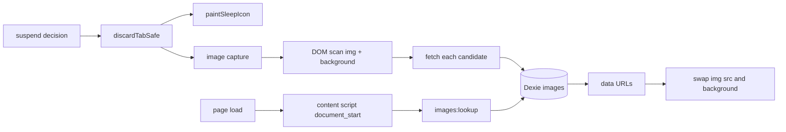

# Image cache

Pins the images a tab was showing into local storage, so waking that tab paints them without the network. A user turns it on in Options → Images, and the store keeps entries for a configurable TTL (default one day) inside a byte budget.

## What Chrome does not allow

An extension cannot answer a network request with bytes it holds. MV3 removes blocking `webRequest`, `declarativeNetRequest` redirects must target a URL Chrome can load (a packaged file or another network URL, never runtime bytes), and a service worker cannot register a `fetch` handler for a page. Any design that claims to serve from cache instead of downloading is fiction.

Two consequences shape this subsystem:

- Chrome's own HTTP disk cache already spares most reloads after a discard. This cache earns its keep where the browser already evicted the entry or the response forbade caching, which is why it needs its own TTL rather than trusting `Cache-Control`.
- The mechanism is substitution: captured bytes are swapped into the page at `document_start`. The parser may still issue the first request for an `img` element it created before the swap. The swap wins the paint, and that is the whole promise.

## Shape

- **Rules**: `core/image-cache.ts`, pure. Key normalization, cacheability, TTL selection, LRU selection.
- **Store**: `core/image-store.ts` over Dexie table `images` in database `tabdorm` (`version(3)`).
- **Capture**: `core/image-capture.ts`, called from inside `discardTabSafe()`.
- **Replay**: `entrypoints/image-cache.content.ts` plus the `images:lookup` message handler.

## Invariants

| Invariant | Why |
|---|---|
| Records are keyed by the normalized absolute image URL, never by tab id | Tab ids are reused across browser runs, and a record must outlive a restart |
| The cache key keeps the query string | Signed CDN URLs differ only there, so dropping it would serve one image's bytes for another |
| Only http and https URLs are captured or replayed | No extension resource, no data or blob echo loop |
| Capture runs only inside `discardTabSafe()` | That function is the single discard funnel, and a second hook would drift from it |
| Capture is bounded by `captureDeadlineMs` | A heavy page must never delay a suspend |
| TTL and budget are enforced on read as well as on sweep | A stalled sweep must not serve expired bytes |
| Every knob is clamped in `resolveConfig` | A stored or imported value can never exceed the ceiling, so a typo cannot fill the disk: budget stops at 8 GB |
| Images never touch `chrome.storage` | That tier caps at 10 MB without `unlimitedStorage` and serializes to JSON |
| A blocked swap restores the original URL | A strict `img-src` CSP must degrade to a normal network load, never a broken image |

## Failure modes

| Symptom | Cause | Behaviour |
|---|---|---|
| Nothing captured | Feature off, or the `scripting` and `<all_urls>` grants missing | Suspend proceeds normally: no mark, no error |
| Images still download | Page CSP refuses data URLs, or the parser requested them before the swap | The original URL is restored on error, so the page behaves as before |
| Capture slow on a gallery page | Many candidates | The deadline stops the scan, and the partial capture is kept |
| Store grows past the budget | Long TTL plus heavy browsing | LRU eviction on the sweep |
| Wake shows a stale signed image | The signed URL expired before the TTL | Shorten `ttlMinutes`; the entry is served only while unexpired |

## Operations

- Options → Images: enable switch, TTL, byte budget, per-image ceiling, pixel floor, live totals, per-host table, clear-all.
- Popup: clear the active tab site's entries.
- Sweep: TTL deletion then LRU eviction, armed on the existing alarm cadence.
- Storage location: IndexedDB `tabdorm` store `images`, inside the extension origin, covered by the existing `navigator.storage.persist()` request.
