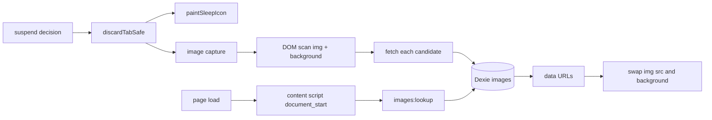

# Image cache

Pins the images a tab was showing into local storage, so waking that tab paints them without the network. A user turns it on in Options → Images, and the store keeps entries for a configurable TTL (default one day) inside a byte budget.

Capture runs twice, with one rule between them: the page announces every picture as it loads, the worker reads the bytes once into a **session band** that dies with its tab, and a suspend **promotes** those rows into the offline store. So a discard costs a table move, and its DOM sweep is left with the gaps.

## What Chrome does not allow

An extension cannot answer a network request with bytes it holds. MV3 removes blocking `webRequest`, `declarativeNetRequest` redirects must target a URL Chrome can load (a packaged file or another network URL, never runtime bytes), and a service worker cannot register a `fetch` handler for a page. Any design that claims to serve from cache instead of downloading is fiction.

Two consequences shape this subsystem:

- Chrome's own HTTP disk cache already spares most reloads after a discard. This cache earns its keep where the browser already evicted the entry or the response forbade caching, which is why it needs its own TTL rather than trusting `Cache-Control`.
- The mechanism is substitution: captured bytes are swapped into the page at `document_start`. The parser may still issue the first request for an `img` element it created before the swap. The swap wins the paint, and that is the whole promise.

## Shape

- **Rules**: `core/image-cache.ts` and `core/image-session.ts`, both pure. Key normalization, cacheability, TTL and LRU for the offline store; session keys, byte floor, session budgets, promotion mapping, and refusal guards for the session band.
- **Store**: `core/image-store.ts` over Dexie tables `images` and `sessionImages` in database `tabdorm` (`version(4)`).
- **Awake capture**: `core/session-capture.ts`, driven by the announce band in `public/image-cache.js` and the `imageCandidates` message. The page sends the bytes for a `blob:` or `data:` picture, capped at 24 MB per picture, 48 MB per page, and 30 inline pictures per page.
- **Suspend capture**: `core/image-capture.ts`, called from inside `discardTabSafe()` after promotion.
- **Replay**: `public/image-cache.js` plus the `images:lookup` message handler.

## Invariants

| Invariant | Why |
|---|---|
| Records are keyed by the normalized absolute image URL, never by tab id | Tab ids are reused across browser runs, and a record must outlive a restart |
| The cache key keeps the query string | Signed CDN URLs differ only there, so dropping it would serve one image's bytes for another |
| Only http and https URLs are captured or replayed | No extension resource, no data or blob echo loop |
| Capture runs only inside `discardTabSafe()` | That function is the single discard funnel, and a second hook would drift from it |
| Capture is bounded by `captureDeadlineMs` | A heavy page must never delay a suspend |
| TTL and budget are enforced on read as well as on sweep | A stalled sweep must not serve expired bytes |
| Every knob is clamped in `resolveConfig` | A stored or imported value can never exceed the ceiling, so a typo cannot fill the disk: the budget stops at 8 GB, and `0` means no cap at all |
| `0` on the budget means TTL-only | `selectOverBudget` returns nothing, so eviction never runs and only expiry removes rows |
| A session row never outlives its tab | `tabs.onRemoved` purges it and browser start empties the band, so a reused tab id can never inherit bytes |
| Promotion is a move, never a copy | the upsert and the delete share one Dexie transaction, so a crash cannot leave the bytes in both bands |
| A key the offline store already holds is touched, not copied | an awake page that reloads its own gallery must not double the bytes, and a wake must never demote a row |
| An inline picture is read in the page, never by the worker | a `blob:` url resolves only in the context that created it, and a `data:` url carries its own bytes, so the worker's fetch can reach neither |
| The announce band walks every root the page paints into | an injected viewer overlay keeps its DOM in an open shadow root, which `document.images` never enters, so the light DOM alone reports a false zero |
| The announce band runs in every frame | a viewer that renders its pictures inside a subframe is otherwise invisible, and each frame keeps its own announce caps |
| An inline row is keyed by its own digest | a viewer mints a fresh `blob:` uuid on every render, so a url key would pile up copies of one picture, and the digest makes the session key agree with the offline one |
| Awake capture adds no manifest permission | it reuses the optional `scripting` + `<all_urls>` grant the enable switch already asks for, and the script runs only while the feature is on |
| A read is refused before the body when `Content-Length` exceeds the ceiling | a 40 MB picture must not be downloaded into the worker to be thrown away |
| One read is hard-capped at 64 MB whatever the config says | the ceiling is a user choice, the cap is memory safety |
| Images never touch `chrome.storage` | That tier caps at 10 MB without `unlimitedStorage` and serializes to JSON |
| A blocked swap restores the original URL | A strict `img-src` CSP must degrade to a normal network load, never a broken image |

## Failure modes

| Symptom | Cause | Behaviour |
|---|---|---|
| Nothing captured | Feature off, or the `scripting` and `<all_urls>` grants missing | Suspend proceeds normally: no mark, no error |
| Images still download | Page CSP refuses data URLs, or the parser requested them before the swap | The original URL is restored on error, so the page behaves as before |
| Capture slow on a gallery page | Many candidates | The deadline stops the scan, and the partial capture is kept |
| Store grows past the budget | Long TTL plus heavy browsing | LRU eviction on the sweep |
| Wake shows a stale signed image | The signed URL expired before the TTL | Shorten `ttlMinutes`; the entry is served only while unexpired |

## Operations

- Options → Images: enable switch, awake capture switch, TTL, storage budget, awake budget, pictures per open tab, per-image ceiling, response byte floor, pixel floor, live totals for both bands, per-host table, clear-all (which clears both bands).
- Options → Gallery: both bands in one grid, newest first, session rows tagged as a live tab.
- Popup: clear the active tab site's entries.
- Sweep: TTL deletion then LRU eviction on the offline store, budget eviction on the session band, armed on the existing alarm cadence.
- Storage location: IndexedDB `tabdorm` stores `images` and `sessionImages`, inside the extension origin, covered by the existing `navigator.storage.persist()` request.
- Probe: open a gallery page, watch Options → Images totals rise before any suspend, then sleep the tab and confirm the rows moved to the offline band and the tab repaints.
- Probe for a viewer that paints `blob:` pictures: Options → Images rises while the tab stays awake, and each row is one picture rather than a fresh copy per render.
- The page prints one line six seconds after load: `[tabdorm] pictures on this page: N seen, M page-held sent, K unreadable`. A page that keeps nothing names its own reason there. A closed shadow root stays unreadable by design.
